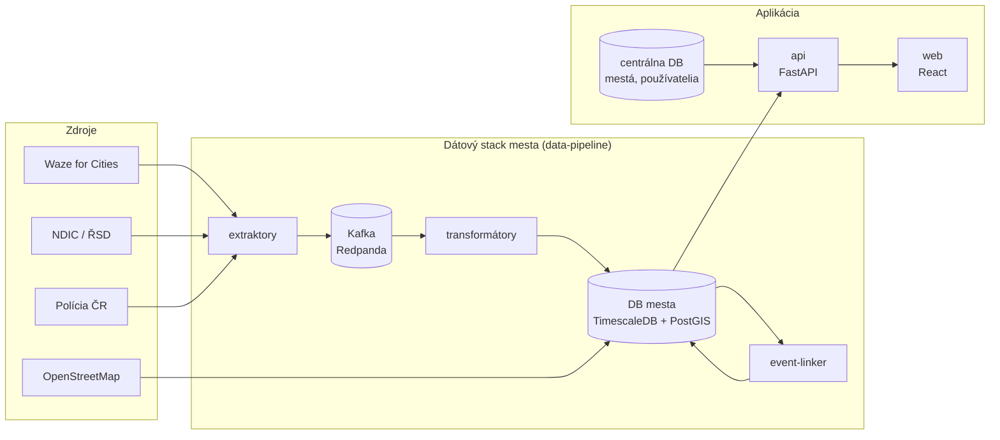
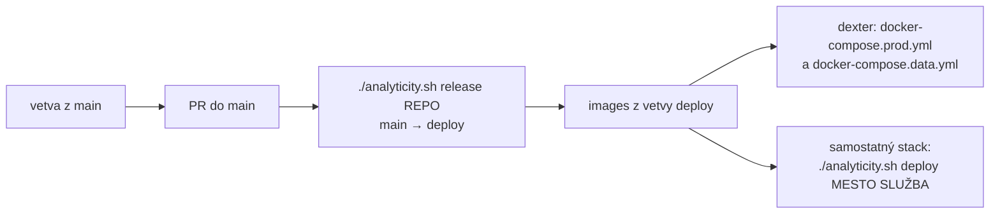

# Analyticity

Webová aplikácia na analýzu dopravy v meste. Spája zápchy a hlásenia z Waze for Cities, nehody
z evidencie Polície ČR a uzávierky z NDIC (ŘSD ČR), premieta ich na cestnú sieť z OpenStreetMap a
hľadá medzi nimi súvislosti (nehoda → zápcha). Ukazuje ich na mape, v dashboardoch a v
prípadových štúdiách. Vyvíja sa na FIT VUT v Brne.

**Naživo:** <https://dexter.fit.vutbr.cz/analyticity/brno/>

Toto je zastrešujúce repo: neobsahuje zdrojový kód aplikácie, ale skladá ju z ostatných
repozitárov (git submoduly), spúšťa ju lokálne a nasadzuje na server.

## Ako to do seba zapadá



- **Každé mesto má vlastnú DB** s dátami; centrálna DB je spoločná (mestá, používatelia,
  nastavenia, osobné API kľúče).
- **Jedno `api`** slúži mapu, dashboardy, prípadové štúdie, rizikové úseky, surové tabuľky aj
  administráciu pod `/api/v1`, vždy s hlavičkou `X-API-Key`.
- **`web`** je jeden image pre všetky mestá; mesto, stred mapy a adresu API dostane pri štarte
  kontajnera (`config.js`).

## Repozitáre

| Repo | Obsah | Tu ako |
|---|---|---|
| [`api`](https://github.com/analyticity/api) | backend (FastAPI) | `sources/backend` |
| [`web`](https://github.com/analyticity/web) | frontend (React, TypeScript, Vite, Leaflet) | `sources/ui` |
| [`data-pipeline`](https://github.com/analyticity/data-pipeline) | extraktory, transformátory, event-linker, migrácie DB mesta (Java, Quarkus) | `sources/data-pipeline` |
| [`central_analyticity_db`](https://github.com/analyticity/central_analyticity_db) | centrálna DB | `db` |
| [`simulations`](https://github.com/analyticity/simulations) | dopravný model mesta (AequilibraE) | – |

Submoduly sledujú vetvu `deploy` daného repa, teda to, čo beží na serveri. `api`, `web`,
`data-pipeline` a `central_analyticity_db` sú súkromné; ľudia na projekte majú k dispozícii aj
internú dokumentáciu (repo `docs`, `./analyticity.sh docs`).

## Rýchly štart

Aplikácia na vlastnom počítači so vzorovými dátami: centrálna DB, `api` a `web`, bez Kafky a
extraktorov. Potrebuješ Docker Desktop.

```bash
git clone --recurse-submodules git@github.com:analyticity/analyticity.git
cd analyticity
./analyticity.sh local:up               # zo submodulov (vetvy deploy)
./analyticity.sh local:up --workspace   # z tvojich klonov ../api, ../web, ../central_analyticity_db
```

| | |
|---|---|
| Web | <http://localhost:8090> |
| API (Swagger) | <http://localhost:8091/docs>, kľúč `dev-full-key` (web používa `dev-local-key`) |
| Administrácia | `VutAdmin` / `Test` (len lokálne, zo seedu centrálnej DB) |
| Centrálna DB | `localhost:5439`, `db` / `local`, databáza `central_db` |

Prvý build trvá niekoľko minút (na Apple Silicon sa images buildia pre `linux/amd64`). Po zmene
kódu stačí znova `local:up`. Porty sa dajú zmeniť, napr. `LOCAL_UI_PORT=9090 ./analyticity.sh local:up`.

```bash
./analyticity.sh local:logs api     # logy
./analyticity.sh local:down         # zastaví, dáta centrálnej DB ostanú
./analyticity.sh local:reset        # zmaže centrálnu DB, pri ďalšom up sa naplní zo seedu
```

## Príkazy pre vývoj

```text
local:up [--workspace]      aplikácia lokálne (vzorové dáta), zo submodulov alebo z tvojich klonov
local:down | local:reset | local:logs [služba] | local:status
docs [port]                 interná dokumentácia (repo docs vedľa tohto), http://localhost:8000
```

Postup práce: vetva z aktuálneho `main` v repe, ktorého sa zmena týka (`api`, `web`,
`data-pipeline` …), overenie cez `./analyticity.sh local:up --workspace`, PR do `main`. Vydanie a
nasadenie robí správca.

## Štruktúra

```text
analyticity/
├── analyticity.sh               riadiaci skript
├── docker-compose.prod.yml      dexter: centrálna DB, api, web, proxy
├── docker-compose.data.yml      dexter: dátový stack Brna
├── docker-compose.build.yml     build a push images do registry dexteru
├── nginx.conf                   proxy projektu na dexteri (rozcestník miest, /brno/)
├── init_db_central.sql          seed centrálnej DB pre dexter (configure/sync-data)
├── .env.example, .env.data.example
├── local/                       lokálny stack (local:up)
├── cities/<mesto>/              samostatné stacky miest (brno, orp_most, praha)
├── templates/                   šablóna nového mesta (setup)
├── infrastructure/              infra compose pre samostatné stacky (TimescaleDB, Redpanda, služby)
├── db/                          submodul central_analyticity_db
└── sources/                     submoduly api (backend), web (ui), data-pipeline
```

Do `sources/` a `db/` sa zmeny nerobia; patria do príslušného repa. `.env` súbory sú v
`.gitignore` a do gitu nepatria nikdy.

## Dáta a ich podmienky

Dáta Waze for Cities sa nesmú zverejňovať, preto ich verejné časti aplikácie ukazujú len
agregované. Každý pohľad s dátami uvádza zdroje: Waze for Cities, Polícia ČR, NDIC (ŘSD ČR),
© prispievatelia OpenStreetMap.

---

## Pre správcov: nasadenie

> **Táto časť nie je pre študentov.** Študenti nič nevydávajú ani nenasadzujú: aplikáciu
> spúšťajú lokálne ([Rýchly štart](#rýchly-štart)) a zmeny posielajú cez PR do `main`. Vydanie
> do `deploy` a nasadenie na server robí len správca projektu, krok po kroku.

Repo pozná dva spôsoby nasadenia. Navzájom sa nemiešajú.

| | Server dexter (produkcia) | Samostatný stack mesta |
|---|---|---|
| Súbory | `docker-compose.prod.yml` (centrálna DB, api, web, proxy), `docker-compose.data.yml` (dátový stack Brna), `nginx.conf`, `docker-compose.build.yml` | `cities/<mesto>/docker-compose.yml`, `infrastructure/docker-compose.yml`, `templates/` |
| Images | registry dexteru `dexter.fit.vutbr.cz/analyticity/analyticity-*`, build lokálne z vetiev `deploy` | `api` a `web` z `ghcr.io/analyticity` (GitHub Actions); dátové služby zatiaľ zo starších `ghcr.io/dp-traffic/*` v `infrastructure/docker-compose.yml` |
| Konfigurácia | `.env.example`, `.env.data.example` | `cities/<mesto>/.env.example` |
| Príkazy | `./dexter.sh` z repa servera (`build`, `push`, `remote-sync`, `remote-start`) | `./analyticity.sh setup`, `start`, `deploy`, `update` |



Images sa buildia **iba z vetvy `deploy`**; `main` sa najprv overí (lokálne alebo cez
`local:up --workspace`) a až potom vydá príkazom `release` (potrebuje prihlásené
[GitHub CLI](https://cli.github.com/)).

> **Dátový stack nikdy `down -v`.** DB mesta drží históriu Waze, ktorú Waze znova neposkytne.
> `db-migrate` s `RUN_OSM_IMPORT=true` naimportuje cestnú sieť nanovo s novými `id` úsekov.

### Samostatný stack mesta

```bash
docker network create analyticity-network            # raz na server
cp db/centralDbCreation/.env.example db/centralDbCreation/.env && ./analyticity.sh db:start
./analyticity.sh setup orp_liberec                    # cities/orp_liberec/ zo šablóny, vyplň .env
./analyticity.sh ports orp_liberec                    # konflikty portov
./analyticity.sh start orp_liberec                    # prvé spustenie 10–30 min (import OSM)
```

V `.env` mesta: jedinečné porty, `WAZE_URL`, `POLICE_REGION`, `BBOX_*` a `OSM_BBOX`, stred mapy
a názov (`VITE_APP_*`), heslá DB, `SECRET_KEY` (`openssl rand -hex 64`), `API_KEYS` a
`WEB_API_KEY` (`openssl rand -hex 32`, dva rôzne). DB mesta je `POSTGRES_HOST_BRNO=postgres-timescale`;
prípona `_BRNO` je historická a platí pre každé mesto.

### Príkazy správcu

```text
Mestá (samostatné stacky)
  list | setup <mesto> | ports <mesto>
  start | restart <mesto|--all> [profil]     profily: tools, extract, transform, apps, mon, all
  stop | pull | status <mesto|--all>
  update <mesto|--all>                       pull + restart
  deploy <mesto> <služba>                    pull + nové spustenie jednej služby
  logs <mesto> [služba] | topics <mesto> | sync

Centrálna DB
  db:start | db:stop | db:restart | db:logs | db:status

Vydania
  release <repo>                             main → deploy: api, web, central_analyticity_db, data-pipeline, simulations
```

`./analyticity.sh` bez argumentu vypíše úplný zoznam s príkladmi.

---

## Licencia

Copyright (C) 2026 Magdaléna Ondrušková

This program is free software: you can redistribute it and/or
modify it under the terms of the
[GNU Affero General Public License](LICENSE) as published by
the Free Software Foundation, either version 3 of the License,
or (at your option) any later version.

**What this means in practice.** You are free to use, study,
modify and redistribute this software, including for research
and teaching. If you modify it and make it available to others
over a network — for example by running your own instance of
the dashboard or API — you must offer those users the complete
corresponding source code of your modified version, under the
same license.
